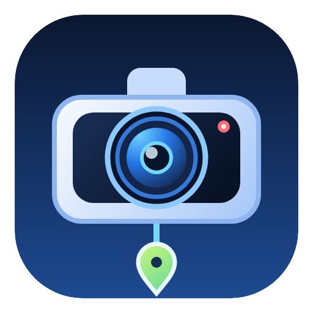

<p align="center"></p>

# Dashcam Remote Control

A Windows desktop app for controlling Pelsee dashcams and browsing their recordings over Wi-Fi.

## Features

- View device status, change camera settings, control recording, and open a live preview.
- Browse the camera SD card with search, front/rear pairing, multi-selection, and folder actions.
- Browse a local folder while offline. The local folder stands in for the SD card; camera downloads stay disabled.
- Queue downloads with per-file progress, cancellation, and clear ready, queued, downloading, completed, and failed states. The queue runs up to five transfers in parallel.
- View file sizes in MB and update them from the downloaded file's actual length.
- Play videos and photos in the app. Read GPS data from recording files and export routes as GPX.
- Flash the app's taskbar button when an operation ends while the window is inactive.

## Requirements

- Windows x64
- .NET SDK 10.0.400 or a later 10.0 patch release
- A Pelsee dashcam and Wi-Fi connection for camera controls and SD-card access

The file explorer can browse local folders without a dashcam connection. The default camera address is `192.168.169.1`; change it in the connection panel when needed.

## Build and run

Run these commands from the repository root in PowerShell:

```powershell
dotnet tool restore
dotnet build dashcam-remote-control.slnx
dotnet run --project src/Dashcam.Remote.Control/Dashcam.Remote.Control.csproj
```

## Tests

Run the unit test suite with:

```powershell
dotnet test dashcam-remote-control.slnx
```

## Architecture

The app uses Avalonia and MVVM. Views bind to view models; device HTTP requests and playback work stay in the service layer. Camera metadata requests are serialized and spaced. File transfers use a separate queue with a maximum of five concurrent downloads.

The camera API uses plain HTTP over Wi-Fi. The app does not use USB drivers.

## Repository layout

| Path | Purpose |
| --- | --- |
| `src/Dashcam.Remote.Control/Views/` | Avalonia windows and AXAML views |
| `src/Dashcam.Remote.Control/ViewModels/` | UI state and commands |
| `src/Dashcam.Remote.Control/Models/` | Device, file explorer, and GPS data models |
| `src/Dashcam.Remote.Control/Controls/` | Custom map and chart controls |
| `src/Dashcam.Remote.Control/Services/` | Device API and playback services |
| `src/Dashcam.Remote.Control/Assets/` | Icons and other app assets |
| `tests/UnitTests/` | xUnit unit tests |
| `docs/STACK.md` | Stack, architecture, and protocol notes |

See [docs/STACK.md](docs/STACK.md) for the technology stack and implementation notes.
